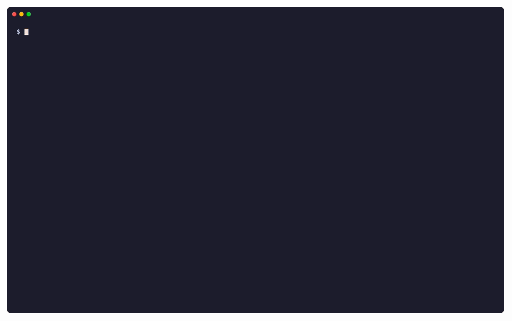

# n8nview

Draw an [n8n](https://n8n.io) workflow in the terminal, and watch it run node by node.

Unofficial, not affiliated with n8n.

```sh
n8nview workflow.json             # draw a workflow you downloaded from the n8n editor
n8nview --mermaid workflow.json   # the same workflow as Mermaid text
n8nview --latest --watch          # follow the execution that is running on your n8n
```

An n8n workflow is a JSON file, and JSON is hard to read in a pull request or over SSH.
n8nview draws it as boxes and arrows made of text. The drawing shows what triggers the
workflow, where it branches, and which model, memory and tools each AI agent uses.
During a run it also shows which nodes finished, which one is running and which one failed.



```
$ n8nview workflow.json
Ticket triage · 10 nodes

                                                 ┌──────────────────┐     ┌──────────────────────┐
                                                 │  Create invoice  │     │  Reply in Slack 💬   │
                                               ╭►│   httpRequest    ├───┬►│        slack         │
                                               │ └──────────────────┘   │ └──────────────────────┘
                                               ├─billing                │
┌──────────────┐  ┌──────────────────┐         │                        │ ╭──────────────────────╮
│  New ticket  │  │  Route by topic  │         │                        │ (  OpenAI Chat Model   )
│   webhook    ├─►│      switch      ├────┬────┤                      ╭┄┼┄(     lmChatOpenAi     )
└──────────────┘  └──────────────────┘    │    │                      ┆ │ ╰──────────────────────╯
                                  support─┤    │                      ┆ │
                                          │    │ ┌──────────────────┐ ┆ │ ╭──────────────────────╮
                                          │  2─┤ │  Support Agent   │ ┆ │ (    Simple Memory     )
                                          ╰────┼►│      agent       ├─┼─┴┄(  memoryBufferWindow  )
                                               │ └──────────────────┘ │   ╰──────────────────────╯
                                               │                      │
                                               │ ┌──────────────────┐ │   ╭──────────────────────╮
                                               │ │   Log to sheet   │ │   (      Calculator      )
                                               ╰►│   googleSheets   │ ├┄┄┄(    toolCalculator    )
                                                 │    (disabled)    │ ┆   (                      )
                                                 └──────────────────┘ ┆   ╰──────────────────────╯
                                                                      ┆
                                                                      ┆   ╭──────────────────────╮
                                                                      ┆   (  Search "docs" [v2]  )
                                                                      ╰┄┄┄(   toolHttpRequest    )
                                                                          ╰──────────────────────╯
```

Solid arrows are the main flow. Dotted lines attach the model, memory and tools to their AI agent. n8nview labels the outputs of IF and Switch nodes, leaves out sticky notes and marks disabled nodes.

n8nview converts the workflow to [Mermaid](https://mermaid.js.org) and draws it with [termaid](https://github.com/fasouto/termaid).

## Install

n8nview is not on PyPI yet, so install it from GitHub:

```bash
pip install git+https://github.com/fasouto/n8nview
```

Or run it without installing:

```bash
uvx --from git+https://github.com/fasouto/n8nview n8nview workflow.json
```

## Usage

```bash
n8nview workflow.json              # draw the workflow
n8nview --mermaid workflow.json    # print the Mermaid source instead
cat workflow.json | n8nview        # read from stdin
n8nview --width 120 workflow.json  # fit to 120 columns, not the terminal width
n8nview --theme nord workflow.json # draw in colour
n8nview --format styled-json workflow.json  # the drawing as JSON, for editors and plugins
```

Each node shows its name and its type. When the drawing is wider than the terminal, n8nview leaves the types out, and then wraps long names.

n8nview reads files and stdin. It calls the n8n API only when you pass `--latest`.

The [examples](examples) folder has workflows to try it on: a chat agent, an IF branch, a loop and an order pipeline.

### Colour and structured output

`--theme` draws in colour with one of termaid's themes: `default`, `terra`, `neon`, `mono`, `amber`, `phosphor`, `gruvbox`, `monokai`, `dracula`, `nord` or `solarized`. Disabled nodes are grey. Colour needs [Rich](https://rich.readthedocs.io/), which is an optional extra:

```bash
pip install "n8nview[color] @ git+https://github.com/fasouto/n8nview"
uvx --from "n8nview[color] @ git+https://github.com/fasouto/n8nview" n8nview --theme nord workflow.json
```

`--format styled-json` prints one JSON document with the title and the drawing. Each line of the drawing is a list of `{"text", "style"}` chunks, and the style names the role of the text, such as `edge`, `arrow` or `class:running` for a node that is running. The Claude Code plugin below picks its colours from these styles.

## Watch an execution

n8nview draws a run of a workflow with a line under each node that says how far it got. The first scene of the recording above is `n8nview --latest --watch --theme default` during a run.

```
$ n8nview --latest
Order pipeline · 7 nodes · execution 5 · running

┌───────────┐ ┌─────────────┐ ┌──────────────┐      ┌──────────────┐
│ New order │ │ Check stock │ │ Should fail? │      │    Crash     │
│  webhook  ├►│    wait     ├►│      if      ├true─►│ stopAndError │
│   ● 0ms   │ │   ● 3.0s    │ │    ● 6ms     │   │  │  ○ pending   │
└───────────┘ └─────────────┘ └──────────────┘   │  └──────────────┘
                                                 ├─false
                                                 │  ┌──────────────┐ ┌───────────┐ ┌──────────────┐
                                                 │  │ Charge card  │ │   Ship    │ │ Send receipt │
                                                 ╰─►│     wait     ├►│   wait    ├►│     set      │
                                                    │  ▶ running   │ │ ○ pending │ │  ○ pending   │
                                                    └──────────────┘ └───────────┘ └──────────────┘
```

`●` marks a node that finished, with how long it took. `▶` marks the node that is running and `○` a node that has not run yet. `×` marks a node that failed, with its error message. `–` marks a node the run never reached. With `--theme`, finished nodes are green, the running node is yellow, failed nodes are red and the rest are grey.

```bash
n8nview --latest                  # the execution that is running, or else the last one
n8nview --latest --watch          # keep redrawing as the run advances, until Ctrl+C
n8nview --latest --workflow ID    # only this workflow's executions
n8nview execution.json            # an execution saved from the API
```

`--latest` calls the n8n API. It reads `N8N_BASE_URL` (default `http://localhost:5678`) and `N8N_API_KEY` from the environment, or from a `.env` file in the current directory. Create the key in n8n under Settings, n8n API.

n8n reports progress node by node only when **Save execution progress** is on, in the workflow's settings or for the whole instance. With the setting off, every node stays pending until the run ends. [examples/order-pipeline.json](examples/order-pipeline.json) has the setting on and three slow steps, so it is a good first workflow to watch.

### Inside Claude Code

The `claude-plugin` folder is a Claude Code plugin. It opens a pane beside the chat when an execution starts and redraws it every second, with each node coloured by its state: green when it finished, yellow while it runs, red when it failed and grey when it has not run. `/n8nview` opens the pane by hand.

```bash
pip install git+https://github.com/fasouto/n8nview
claude --plugin-dir claude-plugin
```

Start Claude Code in a folder whose `.env` has the two `N8N_` settings, or with them in the environment.

## What you can do with it

**Keep a diagram next to each workflow in Git.** GitHub draws Mermaid in Markdown, so the `--mermaid` output works in a README or a pull request description. A reviewer sees what the workflow does without importing it into n8n.

````bash
{ echo '```mermaid'; n8nview --mermaid workflow.json; echo '```'; } >> README.md
````

**Draw what you just copied.** Select nodes on the n8n canvas and copy them. The clipboard holds the same JSON as an export, without the workflow name. On macOS:

```bash
pbpaste | n8nview
```

**Show a workflow to a coding agent.** The drawing and the Mermaid are both plain text, so you can paste either into a chat, or let the agent run `n8nview` itself.

## Development

```bash
uv sync
uv run pytest
vhs docs/demo.tape   # record docs/demo.gif again, with a local n8n running
```

## License

MIT
